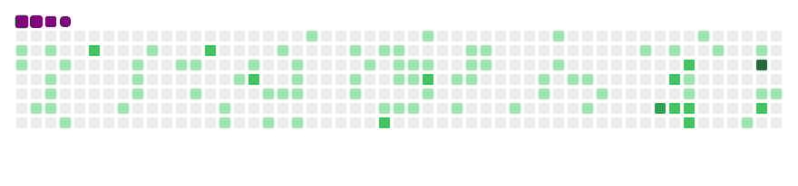
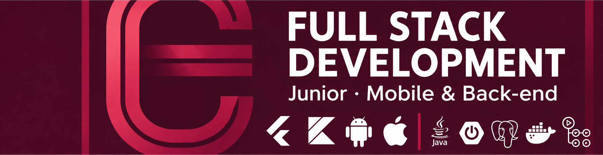

  

 
## 🪪 Biography
 

  

 
## 🇮🇹 Ciao! 
Mi chiamo **Edoardo**, laureato in Sistemi di Informazione presso Estácio.  
Ho studiato **C++, C#, Java** e mi sono innamorato dello sviluppo mobile con **Android 🤖**.  
Oggi lavoro con **Flutter 💙** e **Kotlin 🟣** sul mobile, e con **Java ☕** e **Spring Boot 🍃** sul back-end.
 
## 🇧🇷 Olá! 
Meu nome é **Edoardo**, formado em Sistemas de Informação pela Estácio.  
Estudei **C++, C#, Java** e me apaixonei pelo desenvolvimento mobile com **Android 🤖**.  
Hoje trabalho com **Flutter 💙** e **Kotlin 🟣** no mobile, e com **Java ☕** e **Spring Boot 🍃** no back-end.
 
## 🇺🇸 Hi! 
I am **Edoardo**, graduated in Information Systems at Estácio.  
I studied **C++, C#, Java** and fell in love with mobile development with **Android 🤖**.  
Today I work with **Flutter 💙** and **Kotlin 🟣** on mobile, and with **Java ☕** and **Spring Boot 🍃** on the back-end.
 
## 👨‍💻 About Me
 
### 🇮🇹 Chi Sono
Sono **sviluppatore Junior Full Stack (Mobile & Back-end)**, con focus su **Flutter (Dart)**, **Android nativo (Kotlin/Java)** e **Java con Spring Boot**.  
Nei miei progetti uso architettura **MVVM**, **Jetpack**, principi **SOLID**, **Clean Architecture** e design pattern.  
Con **Flutter** applico **BLoC**, **Provider** e **Riverpod** per gestire lo stato in modo scalabile.  
Sul back-end costruisco **API REST** con **Spring Boot**, **PostgreSQL** e **Docker**, con CI/CD tramite **GitHub Actions**.  
Sviluppo principalmente su **Fedora Linux 🐧**.
 
### 🇧🇷 Sobre Mim
Sou **desenvolvedor Júnior Full Stack (Mobile & Back-end)**, com foco em **Flutter (Dart)**, **Android nativo (Kotlin/Java)** e **Java com Spring Boot**.  
Em meus projetos, utilizo arquitetura **MVVM**, **Jetpack**, princípios **SOLID**, **Clean Architecture** e padrões de projeto.  
Com **Flutter**, aplico **BLoC**, **Provider** e **Riverpod** para gerenciar o estado de forma escalável.  
No back-end, construo **APIs REST** com **Spring Boot**, **PostgreSQL** e **Docker**, com CI/CD via **GitHub Actions**.  
Desenvolvo principalmente no **Fedora Linux 🐧**.
 
### 🇺🇸 About Me
I am a **Junior Full Stack Developer (Mobile & Back-end)**, focused on **Flutter (Dart)**, **native Android (Kotlin/Java)** and **Java with Spring Boot**.  
In my projects I use **MVVM architecture**, **Jetpack**, **SOLID principles**, **Clean Architecture** and design patterns.  
With **Flutter**, I apply **BLoC**, **Provider** and **Riverpod** for scalable state management.  
On the back-end, I build **REST APIs** with **Spring Boot**, **PostgreSQL** and **Docker**, with CI/CD through **GitHub Actions**.  
I mainly develop on **Fedora Linux 🐧**.
 
## 🛠️ Skills

<table>
<tr>
<td align="center">

</td>
<td align="center">

</td>
<td align="center">

</td>
<td align="center">

</td>
</tr>
<tr>
<td align="center">

</td>
<td align="center">

</td>
<td align="center">

</td>
<td align="center">

</td>
</tr>
<tr>
<td align="center">

</td>
<td align="center">

</td>
<td align="center">

</td>
<td align="center">

</td>
</tr>
<tr>
<td align="center">

</td>
<td align="center">

</td>
</tr>
</table>

 
## 📊 GitHub Stats
<table align="center">
<tr>
<td valign="top">

</td>
<td valign="top">

</td>
</tr>
</table>
